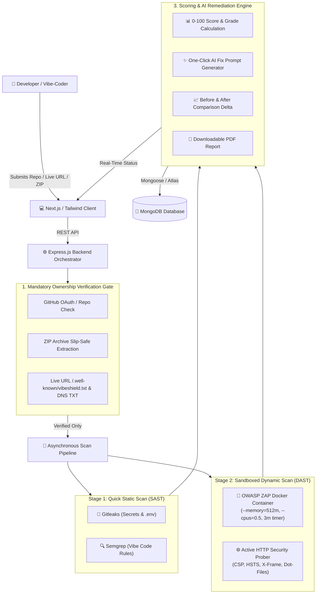

# 🛡️ VibeShield — Automated Security Scanner for Vibe-Coded Applications

[](LICENSE)
[](https://owasp.org)
[](https://semgrep.dev)
[](https://www.zaproxy.org)

**VibeShield** is an automated application security scanner purpose-built for "vibe-coded" web applications and repositories. Tailored specifically for builders using **Cursor, Lovable, v0, Bolt, Replit, and Copilot**, VibeShield removes the jargon and complexity of enterprise AppSec tools and delivers:
1. **Mandatory Ownership Verification** to ensure legal and authorized scans.
2. **Multi-Stage Automated Security Pipeline**:
   - **Stage 1 (SAST ~10–15s)**: Gitleaks secrets detection & custom Semgrep rules for modern AI-generated code gaps (MD5 hashing, plaintext comparisons, missing route auth, weak JWTs, exposed `.env` routes).
   - **Stage 2 (DAST ~1–2m)**: Ephemeral, resource-capped OWASP ZAP Docker sandbox (`512MB RAM`, `0.5 CPU`, `3-min kill timer`) probing XSS, SQLi, and missing security headers.
3. **Beginner-Friendly 0–100 Security Scoring Engine** with grade letter and compliance disclaimer.
4. **One-Click "AI Fix Prompts"**: Context-aware prompts with line numbers, code snippets (with secrets automatically redacted), and drop-in code fixes formatted specifically for AI editors.
5. **Before & After Visual Deltas**: Compare historical scans (e.g., `42/100 ➔ 90/100, +48 points`) with lists of resolved vs. new findings.
6. **Downloadable & Printable PDF Security Reports**.

---

## 🏛️ System Architecture



---

## 🔒 1. Mandatory Ownership Verification Gate

Before running any static or dynamic probes, VibeShield enforces target ownership via one of three methods:

| Method | Target Type | How It Works |
|---|---|---|
| **1. GitHub OAuth / Repo Access** | GitHub Repository | Verifies via GitHub API that the authenticated user holds `push` or `admin` permissions on `owner/repo`. |
| **2. ZIP Archive Upload** | Source Code Upload | Safely unpacks uploaded zip archive inside a sandboxed folder (`/temp_uploads/sandbox_<id>`) with Zip-Slip path traversal defense and file count limits. |
| **3. DNS / File Verification** | Live Website URL | Generates a unique token `vibeshield-verify=vs_tok_<hex>` which the user must host at `/.well-known/vibeshield.txt` or configure as a DNS TXT record. |

---

## ⚡ 2. Multi-Stage Scanning Pipeline

### Stage 1: Quick Static Scan (SAST)
- **Gitleaks**: Detects hardcoded OpenAI API keys (`sk-proj-...`), Stripe secret keys (`sk_live_...`), AWS credentials, GitHub tokens, MongoDB connection URIs with embedded passwords, and committed `.env` files.
- **Semgrep Custom Rules (`server/src/rules/semgrep-vibe-rules.yaml`)**:
  - `vibe-weak-password-hashing`: Detects `MD5`, `SHA1`, and plaintext string comparisons (`=== password`).
  - `vibe-missing-auth-middleware`: Flags sensitive Express routes (`/api/admin/...`, `/api/users/:id`) lacking auth middleware.
  - `vibe-weak-jwt-config`: Flags `algorithm: 'none'` and hardcoded string secrets (`jwt.sign(..., 'secret')`).
  - `vibe-exposed-env-and-debug`: Flags routes exposing `process.env` or unauthenticated debug backdoors.

### Stage 2: Sandboxed Dynamic Scan (DAST)
- **OWASP ZAP Container**: Ephemeral, strictly bounded Docker container:
  ```bash
  docker run --rm --memory=512m --cpus=0.5 --pids-limit=100 -v zap_work:/zap/wrk:rw zaproxy/zap-baseline:stable zap-baseline.py -t <target> -J zap-report.json
  ```
- **Execution Limits**: Auto-kill watchdog timer enforced at 3 minutes (`DAST_TIMEOUT_MS=180000`). Container and host volumes are immediately pruned upon completion.
- **Probes**: Safe non-destructive probes for XSS, SQLi, missing security headers (`Content-Security-Policy`, `Strict-Transport-Security`, `X-Frame-Options`, `X-Content-Type-Options`), open admin endpoints, and exposed `/.env` or `/.git` paths.

---

## 🎯 3. Scoring Engine & One-Click AI Fix Prompts

### Security Score (0–100)
Calculated by deducting weighted penalties from an initial score of 100:
- **CRITICAL**: -20 pts (e.g. hardcoded API key, plaintext password, exposed production `.env`)
- **HIGH**: -20 pts (e.g. missing auth middleware on admin routes, MD5 hashing, missing CSP)
- **MEDIUM**: -10 pts (e.g. missing HSTS, missing X-Frame-Options anti-clickjacking)
- **LOW**: -5 pts (e.g. missing `X-Content-Type-Options: nosniff`)
- **Score Floor**: 0 pts minimum.

> **Legal & Technical Disclaimer:**
> *"A high security score reflects passing automated checks for common known vulnerabilities (OWASP Top 10, exposed secrets, standard configuration gaps) and does not represent a 100% guarantee of immunity from targeted attacks or zero-day vulnerabilities."*

### One-Click AI Fix Prompts
Every finding includes a pre-formatted prompt ready to paste into Cursor, Claude, or ChatGPT:
```markdown
You are a Senior Full-Stack & Application Security Engineer. Please fix a HIGH severity security vulnerability identified in my application.

---
VULNERABILITY DETAILS:
• Issue: Weak MD5 Password Hashing
• Rule ID: vibe-weak-password-hashing-md5
• Severity: HIGH
• Category: CRYPTO
• File: app.js
• Location: Line 26

VULNERABLE CODE SNIPPET:
const tokenHash = crypto.createHash('md5').update(password).digest('hex');

SECURITY REMEDIATION GOAL:
Replace MD5 with bcrypt (salt rounds >= 12) or argon2id for hashing and validating passwords.

INSTRUCTIONS:
1. Provide the exact drop-in replacement code for the affected section in `app.js`.
2. Do not introduce breaking changes to existing business logic.
3. Add clear code comments explaining why the fix satisfies OWASP standards.
---
```
*(All sensitive tokens and connection strings in snippets are automatically masked with `[REDACTED_SECRET]` to prevent leaking secrets to LLMs).*

---

## 📁 Repository Structure

```
Project Alpha/
├── client/                      # Next.js 14 + Tailwind CSS Frontend
│   ├── src/
│   │   ├── app/
│   │   │   ├── layout.tsx       # Root Layout & Theme
│   │   │   ├── page.tsx         # Dashboard Overview & Metrics
│   │   │   ├── scan/
│   │   │   │   ├── [id]/page.tsx# Live Multi-Stage Progress & Interactive Report
│   │   │   │   └── new/page.tsx # Target Submission & Verification Gate
│   │   │   └── targets/page.tsx # Target Management & Re-Scan Deltas
│   │   ├── components/
│   │   │   ├── Navbar.tsx
│   │   │   ├── VerificationModal.tsx
│   │   │   ├── ScoreGauge.tsx   # Circular 0-100 Score Dial & Grade
│   │   │   ├── ScanProgressBar.tsx # Live SAST -> DAST -> Done Stage Tracker
│   │   │   ├── FindingCard.tsx  # Jargon-Free Explanation & Severity Badges
│   │   │   ├── AiFixPromptModal.tsx # One-Click Prompt with Copy Action
│   │   │   ├── BeforeAfterComparison.tsx # Historical Score Delta (+48 pts)
│   │   │   ├── PdfReportView.tsx# Printable PDF View
│   │   │   └── SeverityBadge.tsx
│   │   ├── lib/
│   │   │   ├── api.ts           # Strongly Typed Backend Client
│   │   │   └── utils.ts
│   │   └── types/
│   │       └── index.ts
├── server/                      # Express.js + MongoDB Backend
│   ├── src/
│   │   ├── config/
│   │   │   ├── env.js           # Validated Configuration via dotenv
│   │   │   └── db.js            # Mongoose + In-Memory Fallback Store
│   │   ├── models/
│   │   │   ├── User.js
│   │   │   ├── Target.js        # Target URL/Repo & Verification State
│   │   │   ├── Scan.js          # Multi-Stage Scan Status & Summary
│   │   │   ├── Finding.js       # Findings with Plain-English & AI Prompts
│   │   │   └── Report.js        # Generated Reports & PDF Metadata
│   │   ├── routes/              # Express API Routes
│   │   ├── controllers/         # Verification, Scan, Target & Report Controllers
│   │   ├── services/
│   │   │   ├── orchestrator.js  # Async Job Pipeline Manager
│   │   │   ├── verificationService.js # GitHub / ZIP / DNS Verifier
│   │   │   ├── sastRunner.js    # Child-Process Semgrep & Gitleaks Executer
│   │   │   ├── dastRunner.js    # Sandboxed OWASP ZAP Docker Orchestrator
│   │   │   ├── scoringEngine.js # 0-100 Scoring & Delta Algorithm
│   │   │   ├── promptGenerator.js # Tailored AI Prompt Formatter
│   │   │   └── pdfService.js    # HTML / PDF Report Generator
│   │   ├── rules/
│   │   │   ├── semgrep-vibe-rules.yaml # Custom Semgrep Security Rules
│   │   │   └── gitleaks-custom.toml    # Custom Gitleaks Patterns
│   │   └── utils/
│   │       ├── sanitizer.js     # Path Traversal & Injection Sanitization
│   │       └── logger.js        # Secret-Masked Structured Logger
│   └── test/
│       ├── run-tests.js         # Comprehensive Node.js Test Suite
│       └── verify-rules.py      # Rule Logic Verification Script
├── docker/
│   ├── docker-compose.yml       # Full-Stack Compose Configuration
│   └── zap/Dockerfile           # Hardened ZAP Sandbox Image
└── test-targets/
    └── vulnerable-app/          # Realistic Prototype App for Testing
```

---

## 🚀 Quickstart Guide

### 1. Prerequisites
- [Node.js 18+](https://nodejs.org/)
- [Docker Engine](https://www.docker.com/) (Optional, for running full containerized OWASP ZAP scans)
- [MongoDB Atlas](https://www.mongodb.com/atlas) or local MongoDB instance (The backend includes a zero-config in-memory fallback for local development if MongoDB is not running).

### 2. Configure Environment
```bash
cp server/.env.example server/.env
```

### 3. Start Backend Server
```bash
cd server
npm install
npm run dev
```
The backend API starts at `http://localhost:5000/api`.

### 4. Start Next.js Frontend
```bash
cd client
npm install
npm run dev
```
Open `http://localhost:3000` in your browser.

### 5. Running with Docker Compose
To run MongoDB, the Backend API, and the Next.js Client in a single command:
```bash
cd docker
docker-compose up --build
```

---

## 🧪 Verification & Automated Tests
To execute the automated verification test suite against the included vulnerable test target (`test-targets/vulnerable-app`):
```bash
python server/test/verify-rules.py
```
Expected output:
```
Detected 7 findings in vulnerable target:
  - [HIGH] Weak MD5 Password Hashing (vibe-weak-password-hashing-md5)
  - [CRITICAL] Plaintext Password Comparison (vibe-plaintext-password-compare)
  - [CRITICAL] Insecure JWT none Algorithm (vibe-weak-jwt-none-algorithm)
  - [HIGH] Hardcoded JWT Secret in Code (vibe-hardcoded-jwt-secret)
  - [CRITICAL] Exposed Environment Variables in API (vibe-exposed-env-dump-route)
  - [CRITICAL] Hardcoded OpenAI API Key in .env (openai-api-key)
  - [CRITICAL] MongoDB Credentials in .env (mongodb-connection-uri)

Final Calculated Security Score: 0/100 (Grade: F)
Rule validation logic successfully verified!
```

---

## 📜 Security Policy & Responsible Disclosure
- All user inputs (URLs, file paths, repository addresses) are strictly sanitized against command injection and directory traversal.
- Scans are strictly blocked by the Ownership Verification Gate unless permission is established.
- Submissions and reports do not store unredacted API credentials or live passwords.
